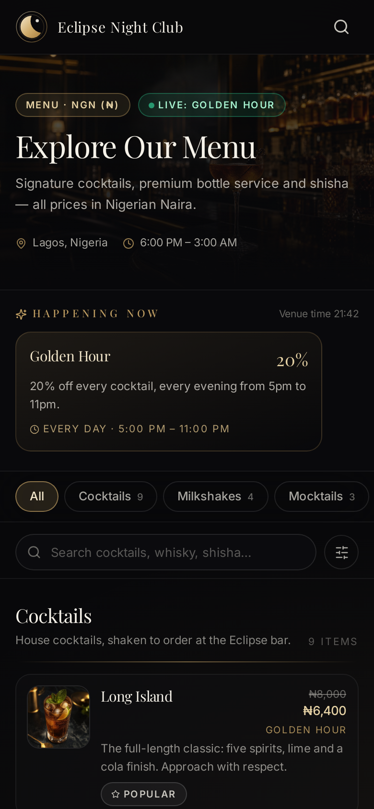
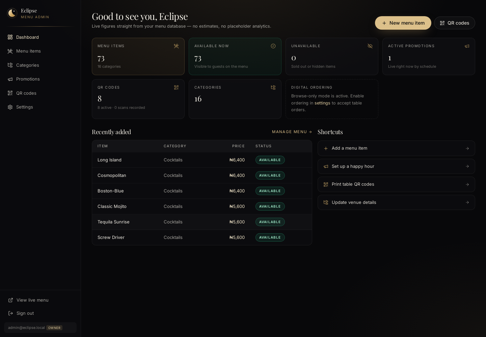

# Eclipse — QR Digital Menu & Admin Platform

A production-ready, mobile-first **QR-code digital menu** for a premium bar / lounge, with a full
administrator dashboard, live promotion scheduling, table-specific QR codes and optional digital
ordering. Built for a real Nigerian venue and pre-loaded with **Eclipse Night Club's actual menu and
prices** transcribed from the venue's printed cards.

```
Customer menu   →  GET /                (public, no login, no app)
Order tracking  →  GET /order/:ref      (public)
Admin dashboard →  GET /admin           (authenticated)
API             →  /api/...
```




---

## 1. What is actually running here

| Layer | Technology | Notes |
|---|---|---|
| Frontend | React 18 + TypeScript + Vite | Customer menu + admin SPA, one bundle |
| Styling | Tailwind CSS (custom design tokens) | Charcoal / champagne-gold design system |
| Icons | Lucide | |
| Validation | Zod | Same schemas on server and in forms |
| Backend | Node 20 + Express + TypeScript | REST API, session cookies, rate limiting |
| Database | **SQLite (better-sqlite3), WAL mode** | Real ACID SQL database, zero external services |
| Auth | bcrypt (cost 12) + HTTP-only session cookies | Server-side sessions in the database |
| QR generation | `qrcode` (PNG + SVG) | Encodes only the menu URL |
| Fonts / images | Self-hosted (`@fontsource`), AI-generated hero art | No CDN dependency |

### Why SQLite instead of Supabase (and how to switch)

The brief asks for Supabase/PostgreSQL. This build ships on SQLite because the deployment target
here is a single self-contained server, and swapping in a hosted Postgres would have required
credentials that you (the client) must create and keep private — I will never invent or embed those.

SQLite is not a mock: it is a real, durable, transactional SQL database with foreign keys, CHECK
constraints, indexes and WAL. Every CRUD operation in the dashboard writes to it and survives a
restart; there is no localStorage-backed menu data anywhere.

To move to Supabase/Postgres (same tables, same columns, same types):

1. Run `supabase/schema.sql` in your Supabase project — it contains the full PostgreSQL schema
   **including Row Level Security policies** for anonymous vs. authenticated access, plus the
   `menu-images` storage bucket.
2. Point the data layer (`src/server/repo.ts` + the route modules) at Supabase, or keep this Express
   API and use `DATABASE_URL` with your SQL gateway.
3. Replace the session-cookie auth in `src/server/auth.ts` with Supabase Auth; `admin_users` is
   already keyed to `auth.users(id)` in the SQL file.

Money is stored as **integer kobo** everywhere (`price = 8000` naira → `800000`), so no floating-point
drift is possible in totals.

---

## 2. Quick start (local)

```bash
cd eclipse-menu
npm install

# 1. Create the database, seed Eclipse's real menu, and print the admin password
ADMIN_EMAIL=admin@eclipse.local ADMIN_PASSWORD='choose-a-strong-password' npm run seed

# 2. Run the API (:4000) and the Vite dev server (:5173) together
npm run dev
```

Open:

* **Menu** → http://localhost:5173/
* **Table QR demo** → `/?t=<token>` (tokens are listed in *Admin → QR codes*)
* **Admin** → http://localhost:5173/admin/login

If you omit `ADMIN_PASSWORD`, the seeder generates a cryptographically random password and prints it
**once** in the terminal.

### Production build

```bash
npm run build          # vite build + server TypeScript compile
npm start              # single Node process serves API + static SPA on :4000
```

`npm start` serves the built SPA with an SPA fallback, so `/admin/items` works on a hard refresh.

---

## 3. Seeded content (from the venue's own menu cards)

* **73 menu items** across **16 categories**: Cocktails, Milkshakes, Mocktails, Tots, Shisha, Beer,
  Single Malt Scotch Whisky, Whisky, Cognac & Brandy, Tequila, Champagne & Sparkling, Vodka, Liqueurs,
  Wine & Cream, Energy Drinks, Beverages.
* Real prices exactly as printed — e.g. Long Island ₦8,000 · Classic Mojito ₦7,000 · Chapman ₦6,000 ·
  Big Heineken ₦5,000 · Hennessy VSOP ₦180,000 · Glenfiddich 21 Years ₦700,000 · Azul Reposado ₦600,000.
* Cocktail ingredients and descriptions taken from the menu card where printed.
* One demo promotion — **Golden Hour**, 20% off selected cocktails, daily 5–11pm — so you can see live
  discounting. Edit or delete it in *Admin → Promotions*.
* 8 QR codes: Main Entrance, Main Bar, VIP 01/02, Table 01–03, Poolside 01.

Every price, description, image, category and label is editable in the dashboard. Nothing is hard-coded
in the UI.

### Images

The hero banner and four product photos in `public/` are AI-generated placeholders. Replace them in
*Admin → Settings* (logo + hero) and in each menu item. Items without a photo get an elegant,
category-aware icon tile instead of a broken image.

---

## 4. Environment variables

Copy `.env.example` → `.env` (the server also reads plain env vars):

| Variable | Purpose | Default |
|---|---|---|
| `PORT` | API / production server port | `4000` |
| `NODE_ENV` | `production` hides internal error messages | `development` |
| `DATA_DIR` | Where the DB and uploads live | `./data` |
| `DATABASE_FILE` | SQLite file path | `./data/eclipse.db` |
| `PUBLIC_BASE_URL` | **Public HTTPS URL encoded into QR codes** | auto-detected |
| `ADMIN_EMAIL` | First admin created by the seeder | `admin@eclipse.local` |
| `ADMIN_PASSWORD` | Password for that admin | random, printed once |
| `WEB_PORT` | Vite dev port | `5173` |
| `API_TARGET` | Vite proxy target in dev | `http://127.0.0.1:4000` |

No secrets are ever shipped to the browser: the frontend only talks to `/api` on the same origin.

---

## 5. Feature map

### Customer menu (`/`)
* Premium charcoal + champagne-gold design, Playfair Display / Inter, mobile-first.
* Sticky compact header with logo, tagline, search and cart; hero banner with live-promotion badge.
* Horizontally scrollable category tabs containing only categories that have visible items.
* Instant search across **name, category, ingredients and description**, plus filters for promotions,
  signature items, popular items and a max-price slider.
* Item cards (desktop) and compact rows (mobile) with prices in ₦, strike-through original prices,
  Signature / Popular / New / Sold-out badges and guest-safe allergen notices.
* Product detail panel: image, description, ingredients, allergens, size, price, promotion.
* Live "Happening now" promotion strip showing the venue clock and schedule.
* Footer with address, contact, opening hours, socials and a staff link.
* Loading skeletons, empty states, friendly error states with retry, and offline-safe error copy.
* Shareable, crawlable URLs with per-venue page title/meta.

### Ordering (optional, off by default)
* Browse-only mode by default: "ask a member of staff".
* When enabled in *Settings*: cart with quantity controls and localStorage persistence (cart only —
  never the menu), table number, guest name, special instructions, server-recomputed totals, unique
  order reference (`ECL-YYMMDD-XXXX`), confirmation screen and public status tracking at `/order/:ref`.
* Orders are only confirmed after the row is committed; **no payment is ever claimed** — payment is
  collected at the table (`payment_status = unpaid`).

### Admin dashboard (`/admin`)
* **Dashboard** — real counts from the database: total / available / unavailable items, categories,
  promotions active *right now*, QR codes and total scans, plus order figures when ordering is on.
* **Menu items** — search, filter by category/status, create, edit, duplicate, soft-delete, reorder,
  inline availability switch, guest-card preview, CSV **export** and **import** (auto-creates missing
  categories).
* **Categories** — create, rename, describe, reorder, hide/show, delete (blocked while items exist).
* **Promotions** — happy hour / special / featured / bundle, percentage discount, day-of-week + time
  window, optional date range, and item scoping (whole menu or a selection).
* **QR codes** — generate per table or area, preview the printable table card, download PNG/SVG,
  print A4 sheets (2 cards per row), copy URL, deactivate/regenerate, delete, and see scan counts.
* **Settings** — business name, logo, hero image/title/message, promo banner, contact, address, city,
  currency, timezone, opening hours per day, social links, menu visibility, ordering mode, default QR
  path, public base URL, and password change.
* Roles: `owner` / `manager` / `staff`. Destructive and configuration actions require owner/manager.

---

## 6. Promotions: how the scheduling works

`src/shared/promo.ts` is the single source of truth, imported by both the API and the browser.

A promotion applies only when **all** of these are true:

1. `is_active` is on;
2. today's date (in the venue timezone, default `Africa/Lagos`) is inside `start_at…end_at` if set;
3. today's weekday is in `days_of_week` (empty = every day);
4. the current venue time is inside `start_time…end_time` (empty = all day).

Windows may cross midnight (e.g. 20:00 → 02:00). Expired promotions can never apply.
Effective price = the **best** of: list price, item promotional price, active promotion discounts.
Because prices are recomputed on every request, a promotion starts and ends without any cron job.

---

## 7. QR codes — design guarantees

* The QR payload is **only a URL** — `https://your-domain/?t=<token>` for table codes, or the plain
  menu URL for general codes. Menu data is never embedded.
* Change any item, price or category and **existing printed codes keep working**.
* The encoded host comes from `PUBLIC_BASE_URL` → *Settings → Public base URL* → request host, in that
  order. Any non-localhost host is forced to `https://`, because phone cameras will not open a
  `http://192.168.x.x` address.
* Table tokens resolve server-side (`/api/public/qr/:token`) — the guest sees "You're ordering from
  Table 07", and orders carry that table automatically.
* The admin UI warns loudly if the configured destination still looks like a localhost/LAN address.
* Error correction level **H** (30%), 4-module quiet zone, dark-on-white for contrast — reliable on
  cheap table cards and under club lighting.
* **Always test one printed code with a real phone camera before ordering a batch.**

---

## 8. Security

* Passwords hashed with bcrypt (cost 12); sessions are 32-byte random tokens stored in the database
  and delivered as `HttpOnly`, `SameSite=Lax` cookies (marked `Secure` over HTTPS).
* Every `/api/admin/*` route is behind `requireAuth`; role checks guard writes.
* Server-side Zod validation on every mutation; prices and order totals are always recomputed on the
  server from the database — the client can never dictate a price.
* Rate limiting on login (8 / 10 min), order creation (10 / min) and order lookup (30 / min).
* Uploads restricted to PNG/JPEG/WebP, max 4 MB, randomised filenames, served with `nosniff`.
* Prepared statements everywhere (no string-concatenated SQL).
* Soft delete for menu items so historical orders keep valid references.
* Audit log of administrative actions (owner-only endpoint).
* Changing a password invalidates every session for that user.
* No secrets or service keys in frontend code.

---

## 9. Tests

```bash
npm run test     # requires the API running: npm run dev:api  (or npm start)
```

`scripts/api-test.ts` runs **69 acceptance checks** against the live API, including:

1. Public menu opens without authentication · 2. Categories and items present · 3. Prices are integer
   kobo · 4. Bad login rejected · 5. Admin API blocked without a session · 6. Anonymous writes
   rejected · 7. Invalid item rejected with field errors · 8. Create item · 9. Edit price · 10. Change
   appears on the public menu · 11. Hide an unavailable item · 12. Duplicate · 13. Promotion applies
   its discount · 14. Promotion outside its weekday does not apply · 15. Expired promotion inactive ·
   16. QR created with URL only · 17. Token resolves publicly · 18. PNG + SVG generated with valid
   signatures · 19. QR destination stable after menu edits · 20. Deactivation kills the QR · 21. CSV
   export/import · 22. Ordering blocked while disabled · 23. Server-side order totals · 24. Name/price
   snapshots preserved when the menu changes · 25. Status updates visible to the guest · 26. Category
   delete guard · 27. Dashboard counts match the table · 28. Cleanup.

### Manual checklist (do this once on a real device)

- [ ] Scan a table QR with an iPhone and an Android camera → menu opens on the right URL.
- [ ] Confirm the table banner appears and orders carry the table number.
- [ ] Search "mojito", "whisky", "shisha" — results are correct and instant.
- [ ] Open an item → ingredients and allergen block render; no invented content.
- [ ] Edit a price in the dashboard, refresh the phone → new price, same QR.
- [ ] Set an item to *Sold out* → it shows as sold out to guests.
- [ ] Create a promotion for the current time window → prices drop everywhere; end it → they return.
- [ ] Close the network mid-load → friendly error + retry.
- [ ] Sign out → `/admin/items` redirects to the login page.
- [ ] Print one QR card and scan the paper copy.

---

## 10. Deployment

### Option A — any Node host (Render, Railway, Fly.io, DigitalOcean, a VPS)

```bash
npm ci
npm run build
PUBLIC_BASE_URL="https://menu.yourvenue.com" NODE_ENV=production npm start
```

Requirements:

* Node 20+
* A **persistent volume** mounted at `data/` — it holds `eclipse.db` **and** `data/uploads/`
  (uploaded images). Without it, everything resets on redeploy.
* Reverse proxy (Nginx/Caddy/Cloudflare) terminating TLS and forwarding to `:4000`.

Run the seeder once on the server:

```bash
ADMIN_EMAIL=owner@yourvenue.com ADMIN_PASSWORD='strong-secret' node dist-server/server/seed.js
```

### Option B — Docker

```bash
docker build -t eclipse-menu .
docker run -d --name eclipse-menu -p 4000:4000 \
  -v eclipse-data:/app/data \
  -e PUBLIC_BASE_URL="https://menu.yourvenue.com" \
  -e NODE_ENV=production \
  eclipse-menu
```

The container seeds an empty database on first boot and exposes a healthcheck at `/api/health`.

### Nginx example

```nginx
server {
  listen 443 ssl http2;
  server_name menu.yourvenue.com;

  ssl_certificate     /etc/letsencrypt/live/menu.yourvenue.com/fullchain.pem;
  ssl_certificate_key /etc/letsencrypt/live/menu.yourvenue.com/privkey.pem;

  client_max_body_size 6m;

  location / {
    proxy_pass http://127.0.0.1:4000;
    proxy_set_header Host $host;
    proxy_set_header X-Forwarded-Proto $scheme;
    proxy_set_header X-Forwarded-For $proxy_add_x_forwarded_for;
  }
}
```

### Custom domain

1. Add an `A` record (or `CNAME` for a managed platform) for e.g. `menu.yourvenue.com`.
2. Issue TLS (Let's Encrypt / platform-managed certificate).
3. Set `PUBLIC_BASE_URL=https://menu.yourvenue.com` (or *Settings → Public base URL*).
4. Open *Admin → QR codes*, confirm the destination shows the new HTTPS URL, then download/print.

### First administrator, securely

* The seeder creates one `owner`. Use `ADMIN_PASSWORD` or let it generate a random one and copy it from
  the console immediately.
* Add staff afterwards:

```bash
npm run admin:create -- --email manager@yourvenue.com --name "Ada" --role manager
```

* Every admin should change their password on first sign-in (*Settings → Change your password*), which
  also invalidates all other sessions.
* With Supabase: create the user in Supabase Auth, then insert the `admin_users` profile row with the
  matching `id`, `business_id` and `role`.

### Generating and printing the final QR codes

1. Set the public HTTPS URL and save.
2. *Admin → QR codes → New QR code* per table/area (leave "table identifier" empty for general codes).
3. **Preview** the card, **Test** the link on your phone, then **PNG**/**SVG** for a single card or
   **Print all (A4)** for the full set (2 cards per row, print-ready layout with logo, code, "Scan to
   View Our Menu", table number and the URL).
4. Print on matte card stock, laminate for table use, and keep the SVG master files for reprints.

---

## 11. Project structure

```
eclipse-menu/
├── index.html
├── public/                     hero art, item photos, favicon
├── scripts/
│   ├── api-test.ts             end-to-end acceptance suite (69 checks)
│   └── create-admin.ts         add an owner/manager/staff account
├── supabase/
│   └── schema.sql              PostgreSQL schema + RLS policies + storage bucket
├── src/
│   ├── shared/                 types, money (kobo), promotion scheduling — used by both sides
│   ├── server/
│   │   ├── index.ts            Express app, static hosting, SPA fallback, errors
│   │   ├── db.ts               SQLite schema, migrations-in-place, slug/audit helpers
│   │   ├── auth.ts             bcrypt, sessions, requireAuth/requireRole, rate limiting
│   │   ├── validation.ts       Zod schemas + field error mapping
│   │   ├── repo.ts             query/serialisation layer, pricing resolution, base URL logic
│   │   ├── seed.ts             Eclipse menu, promotions, QR codes, first admin
│   │   └── routes/             public.ts · auth.ts · admin.ts
│   └── client/
│       ├── pages/              MenuPage, OrderStatusPage, admin/* screens
│       ├── components/         ui primitives, menu components, admin parts
│       └── lib/                api client, auth context
├── data/                       (runtime) eclipe.db + uploads/  ← persist this
├── Dockerfile · .env.example · README.md
```

---

## 12. Known limitations / next steps

* **Single business/tenant.** The schema is already `business_id`-scoped everywhere, so multi-venue is
  a matter of adding venue selection rather than a rewrite.
* **No online payments.** Correct by design — orders are unpaid and settled at the table. Adding
  Paystack/Flutterwave requires your merchant keys; the order flow already stores `payment_status`
  and no confirmation is shown before a real charge.
* **Staff notifications** (WhatsApp/email/webhook on new order) and **sales analytics** are not built;
  the `orders` table already holds everything needed.
* **Image optimisation:** photos are served as uploaded. For very large photography, convert to WebP
  before upload (the admin already accepts WebP).
* **Timezone-correct but minute-granular:** promotions re-evaluate on each request, so a page that is
  left open will reflect a price change on refresh.
